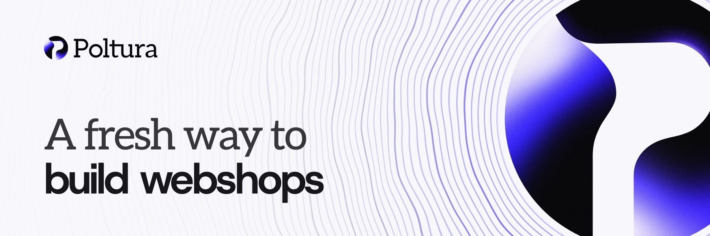

<a href="https://poltura.com">
  <picture>
    <source media="(prefers-color-scheme: dark)" srcset="assets/banner-dark.jpg">
    
  </picture>
</a>

### The webshop that does the work for you.

Poltura is a fresh e-commerce platform for European merchants: easier to set up, faster for shoppers, cheaper to run, with AI in every part of the shop. Build your store free and pay when you open.

<a href="https://poltura.com"><picture><source media="(prefers-color-scheme: dark)" srcset="assets/badge-website-dark.svg"></picture></a>
<a href="https://discord.gg/BBGZurYXRG"><picture><source media="(prefers-color-scheme: dark)" srcset="assets/badge-discord-dark.svg"></picture></a>
<a href="mailto:hello@poltura.com"><picture><source media="(prefers-color-scheme: dark)" srcset="assets/badge-email-dark.svg"></picture></a>
<!--
<a href="https://docs.poltura.com"><picture><source media="(prefers-color-scheme: dark)" srcset="assets/badge-docs-dark.svg"></picture></a>
<a href="https://developers.poltura.com"><picture><source media="(prefers-color-scheme: dark)" srcset="assets/badge-developers-dark.svg"></picture></a>
-->

**For merchants**

- **Meet Klea, your AI assistant.** Klea is built into every Poltura store. Ask her in plain words and she updates products and stock, handles orders and returns, writes descriptions and restyles your store. Anything that moves money or goes live waits for your approval.
- **Design by describing it.** Drag sections into place or tell Klea what you want. Every change lands in a draft you check on desktop, tablet and mobile before publishing.
- **Selling is built in.** Card and local payments, couriers with shipping labels and parcel lockers, and invoices issued automatically for every order.
- **One inbox for every customer.** Website chat and email in one place, with replies drafted for you.
- **Switch without starting over.** Bring your products, customers and orders over from the platform you use today.

**For developers**

- **Connect your AI tool.** Plug Claude, ChatGPT, Codex, Cursor or VS Code into a store over MCP. You choose the store and the access, and risky actions still ask the merchant first.
- **Themes in code.** React themes written in TSX against a typed SDK, edited in the browser or on your own machine with the Poltura CLI.
- **Apps and the App API.** Admin pages, storefront blocks and webhooks from one manifest. The app platform opens to outside developers soon.

<b>Made in the EU.</b> Consent, data requests, VAT and invoicing work the way EU rules expect, from the first day you sell.
